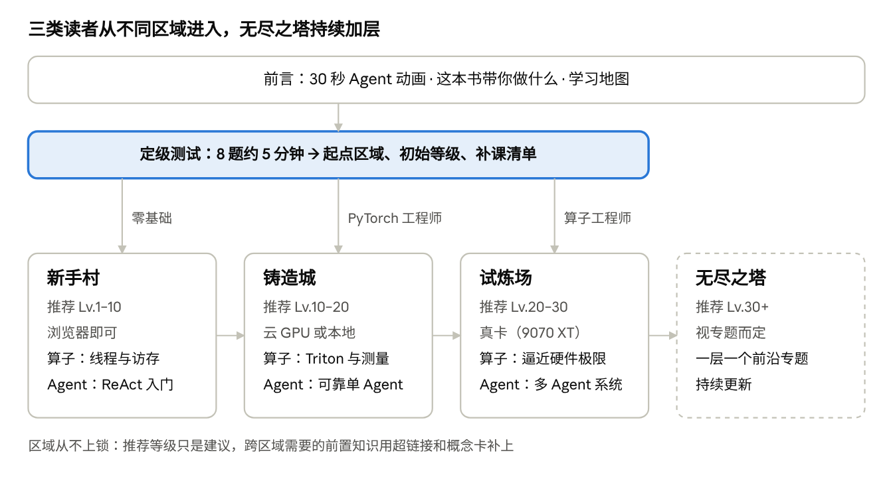
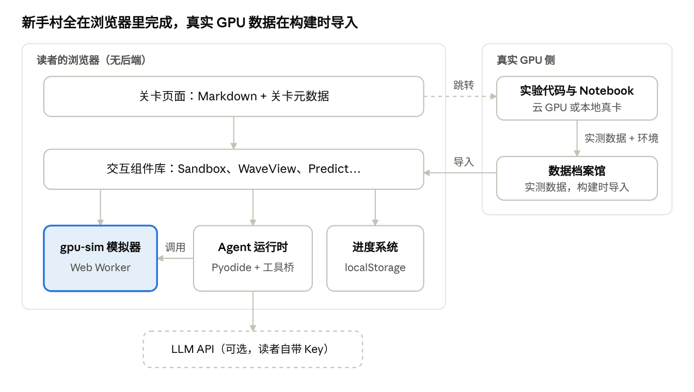
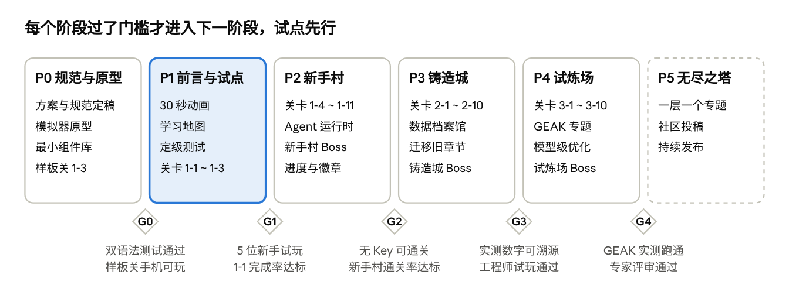

# Hello GPU 重构方案（v1 草案）

Nov 7, 2026 · @plutos

## 摘要

Hello GPU 将从「按章节读的书」重构成「按等级闯关的地图」：零基础读者在浏览器里边玩边入门，PyTorch 工程师和算子工程师通过定级测试，直接从适合自己的区域开始。Agent 优化是贯穿所有区域的第二条主线，也是吸引初学者的钩子。

| 维度 | 决策 |
| --- | --- |
| 整体结构 | 前言 → 定级测试 → 区域 → 关卡。区域之间独立可读，需要前置知识时用超链接或概念卡引用 |
| 等级 | 学习者等级 Lv 由经验值累计，不设上限。每个区域标注「推荐等级」，最后一个区域持续扩展，没有「专家」这个终点 |
| 区域 | 新手村 Lv.1–10（浏览器即可）· 铸造城 Lv.10–20（云 GPU）· 试炼场 Lv.20–30（真卡）· 无尽之塔 Lv.30+（持续更新） |
| 双主线 | 每个区域都有算子线和 Agent 线。Agent 线依次是 ReAct 入门、可靠的单 Agent 闭环、多 Agent 系统（剖析 GEAK） |
| 交互范式 | 每个知识点都走一遍：任务 → 先猜 → 动手 → 即时反馈 → 一句话原理 → 星级 |
| 新手村技术 | 浏览器内置 GPU 模拟器，同时支持 HIP 风格和 Python 风格两种写法。Agent 默认用规则策略加录制轨迹回放，读者也可以填入自己的 API Key 试用真实模型 |
| 前言体验 | 一段 30 秒的网页动画，回放 Agent 把一个 kernel 变快的全过程 |
| 规范先行 | 交互、动效、趣味性、语言、页面模板、视觉六套规范，在写内容之前定稿 |
| 现有内容 | 允许推倒重来。现有的正文、实验和动画作为素材库，迁入铸造城和试炼场 |

交付分五个阶段：P0 定规范、做模拟器原型 → P1 前言、定级测试和新手村 3 关试点，并请新手试玩 → P2 完成新手村 → P3 铸造城 → P4 试炼场。之后，无尽之塔以「一层一个专题」的方式持续发布。

内容以 vibe coding 为主来生产，所以所有规范都写成机器能检查的规则，人把关技术正确性和真实数据。还有 8 项待定，见第 19 节，其中「是否接入匿名统计」最急。

## 1. 现状核查与问题诊断

现有教程的内容和实验很扎实，但它是写给已经入门的工程师的。对零基础读者和 PyTorch 工程师来说，主要障碍有三个：起步门槛高、单页信息过密、交互以看为主。

### 1.1 现有资产

| 资产 | 现状 | 关键数据 |
| --- | --- | --- |
| 正文 | Part 0–4 加附录，按章节线性组织 | Markdown 约 690 KB；第 8 章 78 KB、约 1400 行；第 9–13 章每章 42–61 KB |
| 交互动画 | 通用 `ScenePlayer`，支持分步、擦洗、键盘、减弱动效、视口内自动播放 | 约 40 个 Vue 组件，覆盖第 2、3、8–13 章；动画逻辑有单测（`scripts/tests/`） |
| Notebook | 公共包 `hello_gpu`，用 `%%hip` 单元直接调用 PyTorch Tensor | 共 13 章（第 0–8 章、第 14–17 章）；Agent 章节默认不调用在线模型 |
| 实验与数据 | 每个算子章节都有逐轮实验、复核脚本和 `EXPERIMENT.md` | `code/part2-kernels/chapter8–13` |
| 站点 | VitePress 2.0.0-alpha.18 加 Vue 3.5，带 GPU 图谱和学习路线页 | `docs/.vitepress/` |
| 云平台 | AMD Radeon Cloud（W7900D，注册送 100 小时）；AUP Learning Cloud（Strix Halo 的 Radeon 8060S 和 Strix Point 的 890M，内测中） | `docs/cloud/` |
| 模型级 Agent | 第 19 章有正文；第 18 章只有提纲 | `docs/part4-models-agent/` |
| 写作规范 | CONTRIBUTING 引用了 `.docs-rules/`，但这个目录被 `.gitignore` 忽略，仓库里没有 | 规范没有公开沉淀 |

### 1.2 新手痛点

| 问题 | 证据 | 主要受影响读者 |
| --- | --- | --- |
| 第一步就要硬件 | 第 1 章要求 RX 9070 XT、ROCm 和原生 Ubuntu | 零基础 |
| 单页过载 | 第 8 章一页里讲了基线、地址对照、grid-stride、float4、Triton、rocprof、计数器和负结果 | 所有新手 |
| 交互以「看」为主 | 动画是「播放加旁白」，读者能改的参数很少，也没有预测、目标和反馈 | 零基础 |
| 语气偏论文 | 「受控实验」「负结果」「证据链」「复跑完整性」密集出现 | 零基础、PyTorch 工程师 |
| 入口太多 | README 同时推荐正文、Notebook、云平台、图谱和附录 D | 所有新手 |
| 读者分层只停在表格里 | 第 0 章用一张表给五类读者推荐读法，但正文只有一条线 | PyTorch 工程师、算子工程师 |
| 最吸引人的部分放在最后 | Agent 到第 14 章才出现 | 想通过 Agent 入门的初学者 |
| 规范没有沉淀 | `.docs-rules/` 不在仓库里 | 社区贡献者和 AI 辅助生产 |

结论：内容、实验和动画框架都保留下来作为素材库；结构、入口、交互和语言风格全部重做。

## 2. 重构目标、北极星指标与设计原则

总目标只有一个：每类读者第一次打开教程的 30 分钟内，就能亲手让一个 GPU 程序变快，并且愿意继续打下一关。

### 2.1 分读者目标

| 读者 | 第一个 30 分钟的体验 | 走完推荐区域后的能力 |
| --- | --- | --- |
| 零基础 | 在浏览器里给线程分配工作，亲眼看到越界和加速 | 新手村：讲清线程、wave、访存；写出正确的 kernel；造出一个会自动调参的 ReAct Agent |
| PyTorch 工程师 | 找到模型里最慢的算子，并用 Triton 写出替代版本 | 铸造城：可信计时、rocprof、Roofline；用 Triton/HIP 写行级算子并打败 torch；造一个可靠的优化 Agent |
| 算子工程师 | 用计数器和 trace 解释一个 kernel 到底慢在哪里 | 试炼场：把 kernel 逼近硬件极限；设计并评估多 Agent 系统 |

### 2.2 指标

下表中的初始目标是草案，等 P1 试点拿到数据后再校准。能不能统计，取决于是否接入匿名统计（见「待决策事项」）。

| 指标 | 定义 | 初始目标 |
| --- | --- | --- |
| 首关完成率（北极星） | 打开前言的人中，完成第一关的比例 | ≥ 60% |
| 区域通关率 | 进入某个区域的人中，打败该区域 Boss 的比例 | 新手村 ≥ 30% |
| 先猜正确率 | 「先猜」环节答对的比例 | 保持在 40%–70%；太高说明太简单，太低说明铺垫不够 |
| 卡关点 | 单关平均尝试次数、放弃的位置 | 用来定位要改的关卡，不设硬指标 |
| 数字可溯源 | 正文里的实测数字都能对应到实验档案馆的一条记录 | 100% |

### 2.3 设计原则

1. **先玩后讲**：每关先给任务和可以动手的对象，术语最后才出现。
2. **一关一个想法**：新手村每关 10–15 分钟，只讲一个核心概念。
3. **先猜再验证**：每个关键结论出现之前，先让读者预测。
4. **证据优先**：这是本书的基因，保留下来。任何「变快了」都要能测量、能复现；模拟数字标「模拟」，实测数字标硬件、版本和日期。
5. **渐进披露**：进阶内容放进「深入一点」折叠块；跨区域需要的前置知识，用超链接和概念卡补上。
6. **一份事实，多种深度**：术语、实验和数据全站只维护一份，各区域引用同一份。
7. **零门槛起步，真卡收尾**：新手村只需要浏览器；越往后越接近真实硬件。
8. **无限扩展**：区域和无尽之塔的结构允许一直追加内容，没有终点。
9. **双语法**：HIP 风格和 Python 风格并行，读者选一种，全站记住这个偏好。
10. **能被 AI 稳定生产**：内容主要靠 vibe coding 产出，所以每条规范都要写成机器能检查的规则。

## 3. 读者画像与定级测试

三类主要读者各自从不同区域进入。定级测试用 8 道互动题（约 5 分钟）给出起点区域、初始等级和一份补课清单。不想做测试的读者，可以直接选一张画像卡。

### 3.1 读者画像

| 画像 | 背景 | 来学的动机 | 最大障碍 | 推荐起点 |
| --- | --- | --- | --- | --- |
| 零基础学习者 | 在校生或转行者，会一点 Python | 好奇，想入门 AI Infra；被 Agent 吸引过来 | 不知道 GPU 在干什么，手上没有显卡 | 新手村 1-1 |
| PyTorch 工程师 | 会训练和部署模型 | 模型太慢，想知道慢在哪、怎么改 | 不懂 kernel，不会测准性能 | 铸造城 2-1，附新手村速通清单 |
| 算子工程师 | 写过 CUDA、HIP 或 Triton | 想系统化地优化、熟悉 AMD 平台、用 Agent 自动化 | 不熟悉 AMD 工具链和优化方法论 | 试炼场 3-1，或直接进无尽之塔 |
| 教师或组队学习组织者（次要） | 带课、带学习小组 | 需要现成的课程包 | 缺课时规划和作业 | 每个区域提供课时建议和作业集 |

### 3.2 定级测试

**形式**。共 8 题，覆盖四个维度，每个维度 2 题。题型是拖拽排序、预测输出、指出代码问题这类互动形式，不只是选择题。每题都有「我不知道」选项，避免读者瞎猜。

| 维度 | 考察什么 | 示例题 |
| --- | --- | --- |
| Python 与 PyTorch | 会不会用 Tensor，知不知道 GPU 计时为什么要同步 | 「下面的计时代码测到的是什么？」（缺少 `synchronize`） |
| GPU 概念 | 线程、block、wave、分支发散 | 「一个 wave 里有一半线程走 if、另一半走 else，会发生什么？」 |
| 读 kernel | 能不能读懂下标计算和边界 | 「`i = blockIdx.x * blockDim.x + threadIdx.x`，blockDim = 4 时，block 2 的线程 1 处理哪个下标？」（答案 9） |
| 性能直觉 | 访存、算术强度、瓶颈 | 「相邻线程读相邻地址，和相邻线程间隔 32 个元素读，哪个快？为什么？」 |

**定级规则（草案）**。每个维度 0–2 分。规则自上而下匹配，命中第一条就停。

| 条件 | 起点 | 初始等级 |
| --- | --- | --- |
| 读 kernel = 2，且性能直觉 = 2 | 试炼场 | Lv.20 |
| Python 与 PyTorch ≥ 1，且 GPU 概念 + 读 kernel ≥ 2 | 铸造城 | Lv.10 |
| Python 与 PyTorch = 2，但 GPU 概念 + 读 kernel < 2 | 铸造城，先做新手村速通（约 1 小时） | Lv.8 |
| 其他 | 新手村 | Lv.1 |

**输出**。结果页显示起点区域、初始等级和缺口清单。清单精确到关卡和预计时长，例如「建议先补 1-3 线程分组和 1-7 排好队一起取，约 30 分钟」。跳过的关卡记为「已豁免」：可以随时回去挑战拿星，但不自动给星。

**规则**。可以随时重测；结果只存在本地浏览器；推荐等级只是建议，所有区域从不上锁。

## 4. 等级体系与学习地图

内容按「区域-关卡」组织，学习者等级由经验值累计、不设上限，区域只标推荐等级。这样任何人都能从任意区域开始，新内容也可以一直往后加。



读者读完前言后做定级测试，按结果进入三个区域之一。无尽之塔没有终点，用虚线表示。

### 4.1 四个概念

| 概念 | 定义 | 例子 |
| --- | --- | --- |
| 区域 | 一组主题相关的关卡，带推荐等级和硬件要求 | 铸造城，推荐 Lv.10–20，需要云 GPU |
| 关卡 | 10–40 分钟的学习单元，编号为「区域-序号」；无尽之塔用「第 N 层」 | 2-7 行级算子 Softmax |
| 等级 Lv | 学习者的成长状态，由经验值计算，不设上限 | Lv.14，820/1000 XP |
| Boss 关 | 每个区域最后的综合挑战，通过后获得区域徽章 | 新手村 Boss：修好三个坏 kernel |

### 4.2 区域一览

| 区域 | 推荐等级 | 主题 | 硬件 | 首版关卡 | 毕业 Boss |
| --- | --- | --- | --- | --- | --- |
| 新手村 | Lv.1–10 | 看懂 GPU，造你的第一个 Agent | 浏览器 | 11 关 | 修好三个坏 kernel，用自己的 Agent 把一个 kernel 调到 3 星，并识破一份假加速报告 |
| 铸造城 | Lv.10–20 | 从 PyTorch 到 Kernel，造可靠的优化 Agent | 云 GPU 或本地 | 10 关 | 手写算子打败 torch，再让 Agent 复现，并提交可复核的报告 |
| 试炼场 | Lv.20–30 | 逼近硬件极限，构建多 Agent 系统 | 真卡（9070 XT）或云 | 10 关 | 真实模型的热点 kernel，人加 Agent 联合优化，用端到端 A/B 证明收益 |
| 无尽之塔 | Lv.30+ | 前沿专题，一层一个 | 视专题而定 | 持续追加 | 每层自带挑战 |

### 4.3 经验值与等级

- 完成关卡得 100 XP，每颗星另加 50 XP（最多 3 颗）；Boss 关 500 XP；支线 50–200 XP。
- 每 300 XP 升一级，不设上限。Lv.N 需要累计 300 × (N − 1) XP，所以 Lv.10 需要 2700 XP。
- 按首版内容估算：新手村 11 关、平均 2 星是 2200 XP，加上 Boss 和支线约 3000 XP，刚好到 Lv.10 左右。铸造城和试炼场各自也约带来 10 级。
- 「先猜」环节不给 XP，猜错也不扣分，鼓励读者诚实预测。
- 查看答案后仍然可以通关，但这关最高 2 星。
- 定级测试给出的初始等级直接换算成对应经验值（例如 Lv.10 就是 2700 XP），并标注「定级获得」。

### 4.4 扩展机制

- URL 和存档使用稳定 slug，例如 `/forge/softmax/`。显示编号（如 2-7）按顺序自动生成，所以在中间插入新关卡，不会破坏链接和读者进度。
- 每个区域首版用 10–11 关，之后可以继续追加。
- 无尽之塔一层一个专题。每层自带前置链接、推荐等级和挑战，按发布时间排列；社区可以投稿新的一层。
- 推荐等级可以随内容调整，不影响读者已经拿到的经验值。

## 5. 全书大纲

首版共 31 关加 3 个 Boss，分成前言、三个区域和无尽之塔。每关的标题写成读者学完能回答的问题，时长是估计值，试点后再校准。

### 5.1 前言

| 页面 | 内容 | 交互 |
| --- | --- | --- |
| P-1 30 秒体验 | 网页动画，回放 Agent 把一个 kernel 一步步变快。数据用第 17 章的真实多轮优化记录 | 播放，可跳到任意一步；结尾问「想知道它是怎么做到的吗？」 |
| P-2 学习地图 | 四个区域、三个入口，以及等级和经验值的算法 | 可点击的地图 |
| P-3 定级测试 | 8 道互动题 | 结果页给出起点、等级和补课清单 |
| P-4 怎么玩这本书 | 先猜再验证、星级、HIP/Python 切换、「深入一点」折叠块、进度存在哪里 | 一个 1 分钟的教学关 |
| P-5 关于本书 | 为什么选 AMD 和 9070 XT、和其他教程的区别、贡献者与致谢 | 无 |

### 5.2 新手村（推荐 Lv.1–10，浏览器即可，合计约 3 小时）

| 关卡 | 名称 | 学完能回答 | 核心交互 | 时长 |
| --- | --- | --- | --- | --- |
| 1-1 | 一千道加法 | GPU 为什么快？什么样的任务能并行？ | 分工游戏：把 1000 道加法交给 1 个“教授”或 1000 个“学徒”，比谁快；再换成有依赖的累加，看并行为什么失效 | 10 分钟 |
| 1-2 | 给线程派活 | kernel 是什么？一份规则怎么让许多线程各做一份？ | 沙盒填空：写出 `i = ?`，让每个线程拿到自己的元素 | 10 分钟 |
| 1-3 | 线程分组 | block、grid 和全局下标怎么算？多出来的线程怎么办？ | 拖动 blockDim、gridDim 滑块并写下标公式；挑战「刚好覆盖 10 个数，不越界」 | 15 分钟 |
| 1-4 | 一起行动的小队 | wavefront 是什么？为什么一组线程要锁步执行？ | 锁步单步执行器：看 32 个 lane 同时执行同一行 | 10 分钟 |
| 1-5 | 分岔路口 | if/else 把一个 wave 分成两拨时会怎样？ | 改写分支条件，观察两条路径依次执行和 lane 利用率；挑战把利用率刷到最高 | 15 分钟 |
| 1-6 | 数据住在哪 | 显存、缓存、LDS、寄存器离计算有多远？ | 「取快递」地图：给数据选存放位置，看往返代价（示意值） | 10 分钟 |
| 1-7 | 排好队一起取 | 为什么相邻线程要读相邻地址？ | 调访问步长，看一个 wave 要搬几个 cache line；挑战把事务数降到最少 | 15 分钟 |
| 1-8 | 测一测有多快 | 怎么知道真的变快了？带宽怎么算？ | 计时陷阱游戏：三份测量结果里哪份可信（混有未同步、未预热的结果） | 15 分钟 |
| 1-9 | 大家一起求和 | 结果互相依赖时怎么并行？为什么需要同步？ | 拖拽搭求和树；在沙盒里写块内归约，删掉 `__syncthreads` 看数据竞争 | 20 分钟 |
| 1-10 | 认识 Agent | Agent 是什么？ReAct 循环怎么转？ | 你来当 Agent：看观测结果、选下一步动作，再和规则 Agent 的选择对比 | 15 分钟 |
| 1-11 | 造你的第一个 Agent | 怎样让程序自己调参？ | 补全 ReAct 循环的三个空，在模拟器上自动调 block 大小和步长；可选接入自己的 API Key | 20 分钟 |
| Boss | 新手村毕业考 | 综合 | 修好三个坏 kernel（越界、分支发散、非合并访存）；用你的 Agent 把一个 kernel 调到 3 星；识破一份没同步就计时的「假加速」报告 | 30 分钟 |

Agent 支线分布在 1-3（看 Agent 定位越界 bug）、1-7（Agent 怎么利用事务数这个观测）和 1-8（Agent 会不会被假计时骗到）。这样等读者到了 1-10，已经见过 Agent 三次了。

### 5.3 铸造城（推荐 Lv.10–20，云 GPU 或本地，合计约 7–10 小时）

| 关卡 | 名称 | 学完能回答 | 核心交互 | 时长 |
| --- | --- | --- | --- | --- |
| 2-1 | 开工准备 | 怎么在云上或本地拿到一块能用的 AMD GPU？ | 一键检查脚本：GPU 可见、PyTorch ROCm、HIP 编译、Triton 可用 | 20 分钟 |
| 2-2 | 模型慢在哪 | PyTorch 代码最后变成了哪些 kernel？哪个最耗时？ | 页面内的交互式 trace 浏览器（真实采集数据）；用 Notebook 采集自己的 trace | 30 分钟 |
| 2-3 | 测得准 | 怎样测出可信的 kernel 耗时？ | 噪声模拟器加 Notebook：预热、同步、多次统计、冷热缓存 | 30 分钟 |
| 2-4 | 性能的天花板 | 这个算子最快能有多快？瓶颈是访存还是计算？ | 可以拖动算子点的 Roofline 图，使用 9070 XT 的实测峰值 | 25 分钟 |
| 2-5 | 从线程到 tile | HIP 写法和 Triton 写法怎么对应？ | 双视图联动：点一个 Triton tile，高亮对应的 HIP 线程。Python 路线在这里从线程视角转到 tile 视角 | 25 分钟 |
| 2-6 | 第一个真 kernel | 怎么写出并验证一个比得上 `torch.add` 的 vector add？ | HIP 与 Triton 双实现、正确性检查、有效带宽、block/tile 扫描 | 40 分钟 |
| 2-7 | 行级 Softmax | 为什么要减最大值？行内怎么协作？ | 数值溢出演示加 Notebook；挑战在指定形状下打败 `torch.softmax` | 40 分钟 |
| 2-8 | RMSNorm 与融合 | 融合为什么能省时间？ | 读写字节计数器：对比融合前后搬了多少数据；Notebook 实测 | 35 分钟 |
| 2-9 | Agent 的工具箱 | 怎么把编译、校验、计时、profiling 封装成 Agent 能调用的工具？ | 逐个调用工具，观察失败时 Agent 拿到什么反馈 | 35 分钟 |
| 2-10 | 可靠的优化闭环 | Agent 怎么管理候选？什么时候接受，什么时候停？ | 逐步执行候选闭环；识破噪声范围内的「加速」和只测了一个形状的「正确」 | 45 分钟 |
| Boss | 铸造城毕业考 | 综合 | 选一个 torch 算子（Softmax、RMSNorm 或融合的 bias+GELU），手写版本打败 torch；再让你的 Agent 在同一任务上复现，并提交可复核的报告 | 90 分钟 |

### 5.4 试炼场（推荐 Lv.20–30，真卡或云，合计约 15–25 小时）

| 关卡 | 名称 | 学完能回答 | 核心交互 | 时长 |
| --- | --- | --- | --- | --- |
| 3-1 | 显微镜 | 怎样用硬件计数器和指令跟踪解释性能？RDNA4 上哪些计数器可用？ | 浏览真实的 trace 与计数器；在自己的卡上采集 | 60 分钟 |
| 3-2 | 归约进阶 | wave 内交换、跨块合并、原子操作各有什么代价？ | 逐轮实验对比（真实数据） | 60 分钟 |
| 3-3 | GEMM 一：分块与复用 | 为什么分块能省访存？tile 选多大？ | tile 选择游戏（LDS 容量与复用次数），配 HIP 和 Triton 实现 | 90 分钟 |
| 3-4 | GEMM 二：矩阵核心 | 怎么用 RDNA4 的 WMMA 指令？低精度带来什么？ | 数据布局可视化加实测（可用的精度以实测为准） | 90 分钟 |
| 3-5 | Attention | 在线 Softmax 和 key 分块怎么省掉中间矩阵？ | 手动推进 online softmax 的状态；实测 | 90 分钟 |
| 3-6 | 负结果与适用边界 | 什么样的实验能证明一次优化有效？什么时候该停？ | 浏览逐轮证据：地址排列、grid-stride、float4、tile 扫描 | 60 分钟 |
| 3-7 | 多 Agent 一：分工 | 为什么要拆成多个角色？流程由谁控制？ | 角色流程动画；把你在 2-10 写的单 Agent 改造成多角色 | 60 分钟 |
| 3-8 | 多 Agent 二：记忆与知识库 | 怎样让 Agent 跨轮次、跨任务积累经验？ | 回放洞察黑板和假设台账的变化 | 60 分钟 |
| 3-9 | GEAK 剖析与复现 | 一个工业级多 Agent 系统怎么设计？ | 在容器里用小预算跑 GEAK kernel\_workflow 的示例任务，和自己的 Agent 对比 | 90 分钟 |
| 3-10 | 模型级优化 | kernel 变快了，模型为什么没变快？ | 端到端 A/B：按 Amdahl 定律排优先级，先改配置再改代码 | 90 分钟 |
| Boss | 试炼场毕业考 | 综合 | 选一个真实模型的热点 kernel，人加 Agent 联合优化，用端到端 A/B 证明收益，提交可复现的报告（可进名人堂） | 半天以上 |

### 5.5 无尽之塔（推荐 Lv.30+，持续更新）

下表是候选楼层，顺序和取舍待定，可以让社区投票。每层都独立成篇，自带前置链接和挑战。

| 候选楼层 | 为什么值得做 |
| --- | --- |
| 量化 GEMM 与反量化 | 大模型推理的主要开销之一；可以接着现有第 19 章的 Q4 反量化实测往下做 |
| MoE 算子 | grouped GEMM 和 token 路由是当前模型的热点 |
| Decode 阶段的 attention 与 KV cache | 小 batch 解码是典型的访存瓶颈 |
| 新 DSL：FlyDSL、TileLang、Composable Kernel | 都是 GEAK 支持的后端，读者可以横向比较 |
| 读 ISA 与编译器 | 从 Triton IR 一路看到 AMDGPU 汇编 |
| 换卡：CDNA 与 RDNA | MI 系列和消费卡的差异，接着现有附录 B 写 |
| 多卡与通信 | RCCL 和 all-reduce |
| Agent 前沿 | KernelBench 等评测基准，以及用强化学习训练写 kernel 的模型 |
| 竞赛题解 | 复盘 GPU MODE 等公开 kernel 比赛的题目 |

### 5.6 工具区（常驻，不计入关卡）

工具区包括：环境安装（本地和云）、换卡指南、HIP 速查、Triton 速查、图鉴（术语和概念卡）、GPU 图谱、实验档案馆（真实数据和复现脚本）、常见问题。

## 6. Agent 主线设计

Agent 线按「每一层造出的 Agent，是下一层的零件」来设计：新手村写一个 ReAct 循环；铸造城把它加固成可靠的单 Agent；试炼场再把多个单 Agent 组织成 GEAK 那样的多 Agent 系统。读者到了试炼场会发现，自己在新手村写的循环，就是多 Agent 系统里一个「专家工程师」的雏形。

### 6.1 三层阶梯

| 维度 | 新手村：ReAct 入门 | 铸造城：可靠的单 Agent | 试炼场：多 Agent 系统 | 无尽之塔 |
| --- | --- | --- | --- | --- |
| 关卡 | 1-10、1-11，另有 1-3、1-7、1-8 的支线 | 2-9、2-10 | 3-7、3-8、3-9、3-10 | Agent 前沿专题层 |
| 核心概念 | 思考→行动→观察的循环、工具、观测 | 工具封装、正确性与计时守门、反思、候选管理、预算、停止条件 | 角色分工、确定性流程编排、跨轮记忆、知识库、按 Amdahl 排优先级、逐补丁验证、端到端 A/B | 评测基准、用强化学习训练写 kernel 的模型 |
| 运行环境 | 浏览器模拟器；默认规则策略加录制轨迹回放，可选自带 API Key | 云 GPU Notebook；默认教学策略，可选在线模型 | 真卡或云；Claude Code 或 Codex 加 API Key，在容器沙箱里跑 | 视专题而定 |
| 优化对象 | 模拟器里的 block 大小、tile、访问步长 | Triton 和 HIP 的 vector add、Softmax、RMSNorm | 真实 kernel 和模型推理服务 | — |
| 读者产出 | 一个约 50 行的 ReAct 调参 Agent | 一个能识破假加速的单 Agent，外加一份可复核的报告 | 自己的多 Agent 原型，外加一份和 GEAK 的对比报告 | — |
| 对应现有内容 | 新写（沿用第 14 章「手动注册工具」的思路） | 第 14–17 章及其 Notebook | 第 18–19 章，另加 GEAK 专题 | — |

### 6.2 贯穿所有区域的一个问题：Agent 说变快了，你怎么验证？

每个区域都安排一个「识破假加速」的环节。它一方面延续本书「以证据为准」的基因，一方面防止被 Agent 吸引来的读者跳过基础。

| 区域 | 假加速陷阱 | 读者要学会 |
| --- | --- | --- |
| 新手村 | 没有同步就停表，测到的只是启动时间 | 计时必须等 GPU 算完 |
| 铸造城 | 加速幅度小于测量噪声；只在一个形状上校验了正确性 | 配对 A/B、多形状校验、独立复测 |
| 试炼场 | 单个 kernel 变快了，端到端吞吐却没变 | 单 kernel 的加速只是假设，端到端 A/B 才是结论（GEAK v4 博客的核心观点） |

### 6.3 新手村 Agent 的实现要点

- **默认无 Key 可玩**：规则策略是确定性的；录制轨迹来自真实模型在同一任务上的输出，存成 JSON 逐步回放，并标注「这是一段真实模型输出的回放」。
- **自带 Key 是可选项**：Key 只保存在内存里，不写入 localStorage，也不经过我们的服务器，并明确提示费用和风险。各家 API 是否允许浏览器直连（CORS），实现时逐一核实。
- **代码语言**：Agent 循环用 Python 写，由 Pyodide 在浏览器里运行，只在 Agent 关卡按需加载；工具（编译、运行、计时）通过 JS 桥调用模拟器。读者只补全关键的三个空：选动作、调工具、读观测。
- **可视化**：`AgentConsole` 组件逐条显示思考、行动和观察，支持单步、回放，并和「你刚才的选择」并排对比。

### 6.4 GEAK 接入方案（试炼场 3-9）

核查后的关键事实：GEAK 当前是 v4（4.0.0，Apache-2.0 许可），包含 kernel\_workflow（单 kernel）和 e2e\_workflow（整模型 serving 吞吐）。控制流程用确定性的 JS Workflow 编排，LLM 只负责判断；默认由 Claude Code 驱动，也支持 Codex CLI。官方验证过的硬件是 MI 系列、gfx1151（Radeon 8060S）和 Radeon AI PRO R9700（gfx1201）。RX 9070 XT 虽然也是 gfx1201，但不在验证列表里。细节见第 18 节。

1. **读设计**：用 GEAK README 里「v3 基线 → kernel\_workflow → e2e\_workflow」的对比表讲演进。v3 是 Python 编排加并行 worker；v4 是确定性 JS 加分层角色（Director → TechLead → 算法/访存/计算/主机侧专家）。这本身就是一堂「为什么要这样设计」的课。
2. **零成本看机制**：运行 Codex 路线自带的 runtime 自检（README 注明不需要 GPU 和 Key），先看懂 workflow 怎么转。
3. **小预算实跑**：在容器里对官方示例任务（如 `examples/tasks/knn`）跑 kernel\_workflow，预算设小。README 的启动方式是 `IS_SANDBOX=1 claude --dangerously-skip-permissions`，也就是不经确认就执行命令，所以教程必须配一节「在容器里安全地跑自主 Agent」。
4. **对比与反思**：在同一任务上对比 GEAK 和读者自己的多 Agent，写成报告。
5. **固定版本**：教程锁定 GEAK 的 commit 或 release，并写明「本文基于某版本」。

硬件上有两条路径。一是 AUP Learning Cloud：它的 Strix Halo 正好是 Radeon 8060S（gfx1151），在 GEAK 验证列表里，但需要确认平台允许安装 Claude Code 并访问外网 API。二是自己在 9070 XT 上实测，并标注「未经官方验证，峰值参数自行标定」。GEAK 在 MI300X 上的 3.68 倍几何平均加速，不能作为 9070 XT 的预期。

### 6.5 和 Datawhale hello-agents 的分工

通用的 Agent 基础（记忆、协议、上下文工程、评估）直接链接 hello-agents，不重复写。本书只讲「算子优化场景下」的 Agent：工具怎么守住正确性和计时、怎么做配对裁决、怎么做端到端验证。

## 7. 交互设计规范

每个知识点都必须让读者「动手改变一个东西，并看到后果」。纯播放的动画只能做补充，不能单独承担一个知识点。

### 7.1 核心范式

1. **任务**：一句话说清目标，成败可以判定；用读者的话说，不出现新术语。
2. **先猜**：用选择、滑块估值或排序的形式让读者预测。猜错不扣分，猜对也不加分。预测结果要记录下来，揭晓时对照「你刚才猜的是……」。
3. **动手**：每次只开放 1–3 个可调参数。默认值必须「能跑但不好」，并且随时可以重置。
4. **即时反馈**：模拟器对参数变化的响应控制在 100 ms 内，给出可视化加一句话解读。出错时要说清「哪里错、为什么错」，不能只给一个红叉。
5. **原理**：这时才给出术语和一句话定义，链接到概念卡；细节放进「深入一点」。
6. **星级**：1 星是结果正确，2 星是达到效率目标，3 星是最优解或完成额外挑战。星级标准在关卡开始时就公示。

### 7.2 交互密度

- 每关至少有 1 个「先猜」和 1 个「动手」，新手村每关 4–6 个交互。
- 连续纯阅读不超过约 400 字（大约一屏半）。
- 一个交互只服务一个结论；两个结论就拆成两个交互。

### 7.3 组件清单

关卡只能使用已登记的组件。需要新的交互形式时，先提评审，再加入组件库。

| 组件 | 用途 | 关键行为 | 首次出现 |
| --- | --- | --- | --- |
| `Mission` 任务卡 | 关卡目标和星级标准 | 显示进度和完成状态 | 1-1 |
| `Predict` 先猜 | 选择、估值、排序 | 锁定答案后才能继续；揭晓时做对比 | 1-1 |
| `Knob` 参数控件 | 滑块、步进器、开关 | 键盘可操作；显示单位和取值范围 | 1-1 |
| `Sandbox` 代码沙盒 | HIP / Python 双语法编辑并运行 | 单步、运行、重置；错误定位到行；新手村前几关以填空形式出现 | 1-2 |
| `WaveView` 锁步视图 | 显示 lane 状态、执行掩码、当前行 | 和 Sandbox 联动 | 1-4 |
| `MemoryView` 访存视图 | 显示地址、cache line、事务数 | 和 Sandbox 联动 | 1-7 |
| `ScenePlayer` 讲解动画 | 分步讲解复杂过程（沿用现有组件） | 播放、擦洗、键盘控制、减弱动效 | 1-1 |
| `AgentConsole` Agent 控制台 | 显示思考、行动、观察 | 单步、回放、和读者的选择对比 | 1-10 |
| `TraceViewer` 数据浏览 | 浏览真实的 trace 和计时数据 | 缩放、筛选、悬停查看 | 2-2 |
| `RooflinePlot` | 拖动算子点，判断瓶颈 | 点的位置由算术强度和性能算出 | 2-4 |
| `EvidenceCard` 证据卡 | 标明数字是模拟还是实测；实测的要写硬件、版本、日期和复现命令 | 紧跟在数字旁边 | 1-1 |
| `ConceptCard` 概念卡 | 术语定义，悬停或点击查看 | 首次学到时收入图鉴 | 1-1 |
| `DeepDive` 深入一点 | 折叠的进阶内容 | 默认折叠 | 1-1 |
| `Prereq` 前置引用 | 跨关卡、跨区域的前置链接 | 显示读者是否已完成 | 1-3 |
| `Checkpoint` 小测 | 关卡末尾 2–3 题 | 每个选项都有解释 | 1-1 |
| `LangSwitch` 语法切换 | 在 HIP 和 Python 之间切换，全站记住偏好 | 代码、沙盒、解说同步切换 | 1-2 |

### 7.4 反馈与容错

- **不惩罚**：猜错和运行出错都不扣经验值，可以无限重试。
- **提示阶梯**：失败 2 次给第一级提示（方向），4 次给第二级提示（具体位置），6 次后允许查看答案。查看答案的关卡最高 2 星。
- **错误信息**：按「现象 + 原因 + 下一步建议」来写，编译器原文放进折叠块。
- **自动保存**：每关的代码和参数自动存在本地，刷新不丢。
- **随时可跳过**：每关都有「我已经会了，直接做挑战」的入口。

### 7.5 双语法规则

- 新手村所有代码都同时提供 HIP 风格和 Python 风格两种写法，默认显示读者选择的那一种。
- 两种写法的内建名字保持一致（如 `blockIdx.x`、`threadIdx.x`），只在语法上不同，切换时读者能一眼对上。
- 两种写法由同一个模拟器执行，结果和可视化完全相同。
- 铸造城以后，Python 路线过渡到 Triton，HIP 路线过渡到真实 HIP，由 2-5「从线程到 tile」负责衔接。

### 7.6 可访问性与设备

- 所有交互都能用键盘完成，焦点可见，带 ARIA 标签（沿用 `ScenePlayer` 的做法）。
- 颜色不是唯一的信息通道：越界用「红色 + 斜纹 + 文字」三重表达。
- 新手村所有关卡在 375 px 宽的屏幕上都能完成；手机上的沙盒使用填空或代码块选择，而不是自由输入。
- 首屏 JavaScript 压缩后不超过 200 KB；模拟器和 Pyodide 按需加载。

## 8. 动效设计规范

动效只为解释因果服务。每段动效都要能回答「它让读者看懂了什么」，答不上来就删掉。下面的规范沿用现有 `easing.ts` 和 `ScenePlayer` 的约定，并把它们写成全站规则。

### 8.1 四种用途

| 类型 | 用途 | 例子 | 时长 |
| --- | --- | --- | --- |
| 因果演示 | 展示一个操作带来的后果 | 线程取数、相加、写回 | 每个子动作 400–800 ms |
| 状态过渡 | 参数改变后，布局跟着变化 | blockDim 从 4 改成 8，格子重新分组 | 200–300 ms |
| 注意力引导 | 指出读者该看哪里 | 越界的 lane 闪一下 | 150–250 ms，最多重复 2 次 |
| 反馈 | 操作结果和奖励 | 通关、点亮星级、升级 | 300–600 ms；升级动画不超过 1.5 s，可以跳过 |

### 8.2 时长与缓动

| Token | 取值 | 用在 |
| --- | --- | --- |
| `--motion-instant` | 100 ms | 悬停、按下 |
| `--motion-fast` | 200 ms | 小元素的状态变化 |
| `--motion-base` | 300 ms | 布局过渡 |
| `--motion-slow` | 500 ms | 场景切换、放大缩小 |
| `--motion-scrub` | 420 ms | 拖动时间轴时的补间（沿用现有 `useSceneClock`） |
| 讲解动画每步 | 1500 ms + 旁白字数 × 60 ms，上限 8 s | `ScenePlayer` 的 step（现有旁白约 90 字、时长 4.8–7.4 s，符合这个公式） |

- 进入用 `easeOutCubic`，来回移动用 `easeInOutCubic`，离开用 ease-in。
- `easeOutBack`（带轻微过冲）只用于徽章、星级这类庆祝元素，不用于数据。
- 场景内的分段时序统一用 `seg` / `segE` 表达（例如「本步开始后 200–800 ms 发生」）。

### 8.3 编排规则

- **一次只动一件事**，或者一组同类元素。同组元素按 30–50 ms 错开入场，总错开时间不超过 600 ms。
- **空间约定全站固定**：CPU（主机）在左，GPU（设备）在右；显存在下，计算单元在上；时间从左到右。读的箭头从内存指向计算，写的箭头反过来。
- **对象恒常**：同一个对象在不同场景里保持同样的外观。场景切换用放大和缩小来衔接（如从 grid 放大到 block），不硬切。
- **速度声明**：动画速度和真实 GPU 耗时无关时，必须标注「动画速度不代表 GPU 耗时」（沿用现有做法）。
- **可控**：超过 1 秒的动画都要能暂停、单步、擦洗。自动播放只在进入视口时开始，离开就暂停。
- **和交互联动**：读者改参数时，先立即更新数字，再用 `--motion-base` 过渡图形，不让读者等动画。

### 8.4 可访问性

- `prefers-reduced-motion` 开启时，关闭位移和缩放，改成淡入或直接切换。
- 闪烁频率低于每秒 3 次。
- 动效里的关键信息都要有文字等价物：旁白通过 `aria-live` 播报。

### 8.5 性能

- 只对 `transform` 和 `opacity` 做动画。
- 单个场景的 SVG 元素不超过 2000 个，更多时改用 Canvas。
- 目标 60 fps，低端设备自动降级为单步切换。
- 动画状态写成时间的纯函数（state = f(t)），方便单测，沿用 `scripts/tests` 的做法。

### 8.6 庆祝动效

- 通关：星星依次点亮，每颗间隔 150 ms。
- 升级：等级徽章加经验条增长，不超过 1.5 s，点击即可跳过。
- Boss 通关：颁发区域徽章。
- 不全屏遮挡内容，默认不播放声音。

## 9. 趣味性与游戏化规范

趣味来自「好奇 → 尝试 → 顿悟」的循环，游戏化只是给这个循环加上节奏。任何游戏机制都不能和「学会」冲突：如果一个机制能让人不学也拿高分，就改掉它。

### 9.1 趣味从哪里来

| 来源 | 做法 | 例子 |
| --- | --- | --- |
| 反直觉的结果 | 每关安排一个「你以为……其实……」 | 线程更多反而更慢；float4 没有变快 |
| 真实的冲击 | 用真实数据展示效果 | 前言动画、「真卡验证」支线 |
| 角色与故事 | 吉祥物加一点轻剧情 | 新手村村长委托你「让村里的计算塔跑快一点」 |
| 挑战与选择 | 星级和开放解法 | 同一关用不同的 blockDim 都能过，但只有一种能拿 3 星 |
| 收集与成长 | 经验值、等级、徽章、图鉴 | 学到的每个术语都会收入图鉴 |
| 惊喜 | 隐藏关卡 | 用 WebGPU 在读者自己的显卡上真跑一次并行加法 |

### 9.2 游戏机制

| 机制 | 规则 | 目的 | 防止滥用 |
| --- | --- | --- | --- |
| 经验值 | 关卡 100、每颗星 50、Boss 500、支线 50–200 | 让进度可见 | 先猜不给经验值，避免刷分 |
| 等级 | 每 300 XP 升 1 级，不设上限 | 长期成长感 | — |
| 星级 | 正确、效率、最优各 1 颗 | 鼓励继续优化 | 看过答案最高 2 星 |
| 徽章 | 区域徽章，以及「识破假加速」「零越界」这类能力徽章 | 认可具体能力 | 每枚徽章都对应一项可以验证的能力 |
| 图鉴 | 第一次学到的术语自动收录 | 复习入口 | — |
| 彩蛋 | 隐藏关卡 | 惊喜 | 不影响主线进度 |
| 名人堂（可选） | 提交真实硬件上可复现的优化报告 | 社区荣誉 | 必须附复现命令和环境信息，人工审核；不接受模拟器分数 |

### 9.3 吉祥物

- 建议设一个原创吉祥物，例如一个住在计算单元里的小工匠，和「铸造城」的世界观一致。形象和名字待定。
- 职责是引导、给提示、偶尔轻松吐槽，只出现在任务卡、提示和庆祝动效里。
- 每句台词不超过 30 字；不出现在严肃的数据结论旁边；不过度卖萌。
- 必须原创，不使用任何厂商的商标元素或第三方游戏素材。

### 9.4 世界观与轻剧情

- 全站统一一个比喻体系：GPU 是一座工坊城。kernel 是工作单，线程是工人，wave 是一起行动的小队，CU 是车间，显存是仓库，LDS 是车间里的货架，寄存器是手边的工具台。现有第 2 章已经用了「工作单」的比喻，可以直接延续。
- 每个区域一个主线委托，用一句话写在区域首页，Boss 关是委托的高潮。剧情只是调味料，每关最多两句。

### 9.5 防误导与边界

- 模拟数字一律标注「模拟」，关卡末尾给出真实硬件的对照（来自实验档案馆）。
- 游戏里的简化要在「深入一点」里说清楚，例如模拟器里的 cache line 大小和延迟都是示意值。
- 不用排行榜比较模拟器分数；排行榜和名人堂只接受真实硬件上的提交。
- 不收集个人数据；进度存在本地，可以导出和导入 JSON。
- 不做制造焦虑的机制：没有倒计时、没有断签惩罚、没有「再不学就掉级」。

## 10. 教程语言风格规范

全书的声音像一位耐心的学长在旁边陪你做实验：先说现象和目的，再给术语；句子短，说得具体，说的话都能验证。

### 10.1 分区域的语气

| 区域 | 读者应该感到 | 语气 | 术语 | 代码 |
| --- | --- | --- | --- | --- |
| 新手村 | 「我能行」 | 口语化、鼓励，用第二人称「你」 | 每关新术语不超过 3 个，首次出现必须有大白话解释和概念卡 | 每段不超过 10 行 |
| 铸造城 | 「我在做真实的工程」 | 工程师之间的交流，简洁 | 可以直接用，首次出现链接概念卡 | 每段不超过 30 行，更长的折叠 |
| 试炼场、无尽之塔 | 「我在逼近极限」 | 精确，引用一手资料 | 默认读者懂，附官方文档链接 | 不限长度，但要逐段解读 |

### 10.2 句子与段落

- 句子以 25 字以内为主，不写三层以上的从句。
- 段落不超过 3 句；每屏至少有一个图、交互或代码块。
- 先结论后解释：每节的第一句就是这节的结论。
- 用主动语态和具体的主语：写「线程 5 读取 a\[5\]」，不写「数据被读取」。
- 数字带单位和条件：「在 9070 XT、ROCm 10.0、FP32、n = 2^24 下，有效带宽为 …… GB/s」。

### 10.3 术语规则

- 建立 `glossary.yml` 统一译名。首次出现写「中文（English）」，之后只用一个名字；同一个概念全站只用一个叫法。
- 不翻译的术语也要登记，例如 wavefront、lane、LDS。
- 新手村禁止出现没有解释的缩写。
- 严格区分「模拟」和「实测」，这两个词不能混用。

### 10.4 比喻规则

- 全站只用「工坊城」一套比喻（见 9.4），不混用工厂、学校、快递等多套体系。个别关卡需要其他比喻时，先登记到 glossary。
- 比喻必须服务于一个具体机制，并且紧接着说明它在哪里不成立（「比喻边界」）。例如：「线程像工人，但它并不独占一个处理器。」

### 10.5 禁用与慎用写法

| 不要写 | 改成 |
| --- | --- |
| 「显然」「众所周知」「很简单」 | 直接解释；读者觉得不显然时，这些词会伤人 |
| 「本节将介绍……」 | 直接给结论 |
| 「性能提升明显」 | 「耗时从 1.20 ms 降到 0.85 ms（减少 29%），条件是……」 |
| 「这个优化很重要」 | 说清对什么重要、重要多少 |
| 新手村里的术语串，如「VGPR 占用导致 occupancy 下降」 | 拆成几句，每个术语配概念卡；或者整句移到铸造城 |
| 营销腔，如「史上最强」「一文搞定」 | 删掉 |
| AI 腔，如「让我们一起深入探索」「值得注意的是」「总而言之」「不仅……更……」 | 删掉，直接说事。内容主要靠 AI 生产，这条由 lint 自动检查 |
| 大量网络梗 | 每关最多一处轻松表达 |

### 10.6 改写示例

现有第 8 章导读：「当我们手里有了一个能跑通的正确基线后，如何系统性地判断下一步值得改什么？改动之后又如何科学地决定该保留还是回退？」

- 铸造城版：「你的 vector add 已经算对了。下一步改哪里？改完是留还是退？这一关用三次小实验来回答。」
- 新手村版（1-3）：「10 个数，4 个工人一组。要几组？多出来的工人怎么办？先猜一猜，再拖动滑块看看。」

### 10.7 排版

- 中英文之间加空格，数字和单位之间加空格；中文语境用全角标点。
- 代码、文件名、命令、API 名都用行内代码格式。

## 11. 页面模板与关卡结构规范

所有关卡共用一套固定骨架和一份元数据。这样读者每关都知道去哪里找什么，AI 和贡献者也能照着模板稳定产出。

### 11.1 关卡骨架

1. **关卡头**（自动生成）：编号、名称、推荐等级、时长、硬件要求、前置关卡（超链接）、本关可得经验值。
2. **任务卡**：一句话目标，加星级标准。
3. **热身**：一个「先猜」。
4. **探索**：1–3 段，每段是「一段短文字 + 一个交互 + 一句解读」。
5. **原理**：术语和一句话定义、概念卡，以及「深入一点」折叠块。
6. **挑战**：在沙盒里争取星级。
7. **Agent 视角**（支线，可选）：如果让 Agent 来做这一关，它会观察什么、怎么决策。
8. **小结**：3 条「你现在能……」的能力句。
9. **检查点**：2–3 道题。
10. **下一关**：加上跨区域链接，「回到基础」和「深入一层」各一个。
11. **证据与参考**：模拟或实测数据的来源，以及延伸阅读。

### 11.2 元数据

每关的 frontmatter 按下面的结构填写，由构建脚本校验。

```yaml
id: novice-thread-groups       # 稳定 slug，用于 URL 和进度存档
zone: novice                   # novice | forge | trial | tower
order: 3                       # 显示编号由它生成，如 1-3
title: 线程分组
recommendedLv: 2
duration: 15                   # 分钟
hardware: browser              # browser | cloud | gpu
prerequisites: [novice-assign-work]
newTerms: [block, grid, global-index]   # 新手村不超过 3 个
stars:
  - 所有元素都被计算，且结果正确
  - 没有越界写
  - 用到的线程数最少
langs: [hip, python]
agentSideQuest: true
evidence: simulated            # simulated | measured | mixed
```

### 11.3 文件组织

```text
docs/
  preface/                 前言与定级测试
  novice/                  新手村，每关一个目录
    03-thread-groups/
      index.md             正文
      scenes/              本关专属的可视化
      challenge.ts         星级判定逻辑（纯函数，带单测）
  forge/  trial/  tower/   其余区域，结构相同
  codex/                   图鉴：glossary.yml 与概念卡
  lab/                     实验档案馆：真实数据与复现脚本
packages/
  gpu-sim/                 模拟器（HIP 和 Python 两个前端 + 锁步解释器 + 访存与计时模型）
  ui/                      交互组件库
```

### 11.4 长度与密度预算

| 区域 | 正文字数 | 交互数 | 单段代码 | 时长 |
| --- | --- | --- | --- | --- |
| 新手村 | 1500–2500 字 | 4–6 个 | 不超过 10 行 | 10–20 分钟 |
| 铸造城 | 2500–4500 字 | 3–5 个，外加 Notebook | 不超过 30 行，更长的折叠 | 20–45 分钟 |
| 试炼场 | 4000–8000 字 | 2–4 个，外加真卡实验 | 不限，要逐段解读 | 60–90 分钟 |
| 无尽之塔 | 视专题而定 | 至少 1 个挑战 | 不限 | 视专题而定 |

### 11.5 跨区域引用

- 前置知识用 `Prereq` 组件引用，例如生成「前置：线程分组（1-3）」，并显示读者是否已经完成。
- 术语第一次出现时用概念卡，不复制定义。
- 同一主题在相邻区域的页面互相链接，即「回到基础」和「深入一层」。
- 不把整段内容复制到另一个区域；确实需要时，引用原文并写一句话摘要。

## 12. 视觉规范

全站用一套固定的颜色语义和 GPU 元素画法：读者在任何一关看到同一种颜色或形状，都代表同一个意思。现有站点已经有品牌绿 `#306753` 和 `--hg-semantic-a/b/c` 三个语义色，新规范在它们的基础上扩展。

### 12.1 颜色语义

| Token | 含义 | 用在 |
| --- | --- | --- |
| `--hg-brand` | 品牌（沿用现有绿色） | 导航、按钮、链接；不用在示意图的数据上 |
| `--hg-thread` | 活跃的线程或 lane | WaveView、线程格子 |
| `--hg-inactive` | 被屏蔽或空闲的 lane | 分支发散、尾部线程 |
| `--hg-mem-global` | 显存 | MemoryView、数据流箭头 |
| `--hg-mem-lds` | LDS 和共享内存 | 归约、GEMM 分块 |
| `--hg-reg` | 寄存器 | 线程内部的临时值 |
| `--hg-ok` | 正确、通过 | 校验通过、星级达成 |
| `--hg-error` | 越界、错误 | 越界写、数据竞争、编译错误 |
| `--hg-warn` | 性能警告 | 非合并访存、低利用率 |
| `--hg-focus` | 当前焦点 | 每屏最多一处 |
| `--hg-sim` / `--hg-measured` | 模拟数据 / 实测数据 | EvidenceCard 的标记 |

- 每个 token 都有亮色和暗色两套取值，文字对比度达到 WCAG AA。
- 色盲安全：不只靠红绿区分。越界加斜纹，正确加对勾，屏蔽用空心。
- 品牌绿和 `--hg-ok` 必须拉开色相或明度，避免读者把「品牌元素」误读成「通过」。

### 12.2 GPU 元素的统一画法

| 元素 | 画法 |
| --- | --- |
| 线程 / lane | 圆角小方格，里面写编号；活跃时实心，屏蔽时空心加斜纹 |
| wavefront | 一行 lane 组成的横条，左侧标 wave 编号 |
| block / workgroup | 带标题的圆角容器 |
| grid | 最外层的虚线容器 |
| 显存 | 画面底部的长条，带地址刻度 |
| cache line | 显存长条上的分段括号，大小按硬件参数画，模拟器里标注「示意」 |
| LDS | CU 内部的货架状方块 |
| 寄存器 | 线程格子旁边的小槽位 |
| 数据流 | 带箭头的线；读是从内存指向计算，写反过来；颜色跟随数据所在的层级 |
| CU / SIMD | 车间形状的容器，只在需要硬件细节时出现 |

### 12.3 版式

- 字体沿用现有站点设置；代码用等宽字体。
- 图示中的文字不小于 12 px。
- 所有图示适配 375 px 宽度，需要时提供竖版布局（沿用 `ScenePlayer` 的 `mobileViewBox` 做法）。

### 12.4 明暗主题

- 所有颜色都走 CSS 变量，SVG 里不写死颜色。
- 暗色主题下适当降低饱和度，保持语义色之间的区分度。

### 12.5 区域视觉识别

- 每个区域有一个主色、一个图标和一种插画氛围：新手村是嫩芽，铸造城是铁砧，试炼场是剑，无尽之塔是塔。
- 区域主色只用在区域首页、地图和关卡头，不进入示意图，以免和语义色冲突。

### 12.6 插画与吉祥物

- 扁平的线条风格，和示意图的画法统一。
- 全部原创，不使用第三方游戏素材或厂商商标元素。

## 13. 技术架构

站点框架继续用 VitePress 加 Vue，在此基础上新增三块核心能力：浏览器内的 GPU 模拟器、交互组件库、本地进度系统。真实 GPU 的部分继续由云 Notebook 和本地实验承担，它们产生的数据在构建时导入页面。



高亮的 gpu-sim 是工作量最大的自研部分。虚线箭头表示页面只提供链接，读者跳到 Notebook 在真实 GPU 上动手。

### 13.1 模块与选型

| 模块 | 职责 | 选型 | 备注 |
| --- | --- | --- | --- |
| 站点 | 内容渲染、导航、搜索 | VitePress（当前 2.0.0-alpha.18）加 Vue 3.5 | 沿用；P0 评估是否升级到稳定版 |
| gpu-sim 模拟器 | 解析 HIP 风格和 Python 风格的 kernel，按 wavefront 锁步执行，记录访存、分支和同步事件 | TypeScript，不依赖第三方库，在 Web Worker 里运行 | 核心自研 |
| 成本模型 | 把事件换算成模拟耗时、事务数、lane 利用率 | 简化模型，参数可配置 | 所有输出都标注「示意」 |
| 可视化层 | WaveView、MemoryView 等 | Vue 加 SVG，元素太多时改用 Canvas | 订阅模拟器的事件流 |
| 交互组件库 | 第 7 节列出的组件 | Vue 组件，props 写成文档 | AI 生产关卡时只能用已登记的组件 |
| Agent 运行时 | ReAct 循环、工具调用、轨迹回放 | Pyodide（只在 Agent 关卡按需加载）加 JS 工具桥 | 可选自带 Key |
| 进度系统 | 经验值、等级、星级、徽章、定级结果 | localStorage，支持导出和导入 JSON | 没有账号也没有后端 |
| 数据档案馆 | 真实实验数据（JSON/CSV）和复现脚本 | 构建时导入 | 数据来自 `code/` 下的实验 |
| Notebook | 铸造城和试炼场的动手部分 | 现有 notebooks 和 `hello_gpu` 包 | 在云平台或本地运行 |
| 质量工具 | 规范检查、单测、截图测试 | Node 脚本、Vitest、Playwright | 扩展现有 `scripts/tests` |

### 13.2 模拟器设计

**两个前端，一个内核**。HIP 风格和 Python 风格各有一个语法解析器，输出同一种语法树，由同一个解释器执行。两个解析器都自己写，不引入 Pyodide，这样 kernel 沙盒的加载成本很低。

| 支持的子集 | HIP 风格 | Python 风格 |
| --- | --- | --- |
| kernel 定义 | `__global__ void f(float* a, int n)` | `@kernel` 装饰的 `def f(a, n):` |
| 内建变量 | `blockIdx.x`、`blockDim.x`、`threadIdx.x`、`gridDim.x` | 同名 |
| 类型 | int、float、bool、一维数组 | 同上（自动推断） |
| 控制流 | if/else、for、while（有次数上限） | if/else、for range、while |
| 共享内存与同步 | `__shared__ float s[64];`、`__syncthreads()` | `s = shared(64)`、`syncthreads()` |
| 原子操作 | `atomicAdd` | `atomic_add` |
| 后续扩展 | wave 内交换、二维索引 | 同左 |

**执行模型**

- 每个 block 拆成若干 wave，默认 wave32（和现有第 2 章一致），可以切换到 wave64。
- wave 内锁步执行，用执行掩码表示哪些 lane 在工作；遇到分支时，两侧依次执行。
- block 内支持 barrier；缺少同步时，模拟器能检测并标出数据竞争。
- block 之间的执行顺序可以设为随机，用来演示「block 顺序不确定」。
- 自动检测越界读写，精确到具体的线程和代码行。

**访存和计时模型**

- 记录每个 wave 每条访存指令访问的地址集合，按 cache line 合并，得到事务数。铸造城之后加上 LDS bank 冲突统计。
- 模拟耗时 = 指令数 × 每条指令的周期 + 事务数 × 访存代价 + 同步代价。参数都是示意值，只用来比较「哪种写法更好」，不代表真实硬件。

**安全与测试**

- 循环次数和指令数都有上限，防止死循环；在 Web Worker 里运行，超时可以终止。
- 双前端一致性测试：同一个 kernel 的两种写法，必须得到相同的语法树和结果。
- 正确性对照：教学 kernel 在模拟器和真实 GPU 上的数值输出一致。

### 13.3 可选的 WebGPU 彩蛋

主流浏览器到 2025 年底都已支持 WebGPU。彩蛋关用 WGSL 在读者本机的 GPU 上真跑一次并行加法，让人感受「并行真的快」。但它不进主线，也不用来下任何性能结论：WGSL 不是 HIP，浏览器里的计时也不准。

## 14. 内容生产流程与质量门禁

内容主要靠 vibe coding 生产，所以规范必须写成 AI 能读、机器能查、人能快速审的形式。人把关的重点是技术正确性和真实数据，而不是排版。

### 14.1 生产流水线

1. **关卡卡片**（人写，不超过一页）：目标、核心问题、反直觉点、交互设想、星级标准、前置关卡，以及需要哪些真实数据。
2. **AI 生成初稿**：按模板生成 `index.md`、交互配置、`challenge.ts` 和单测。生成前必须读取 `AGENTS.md` 里的规范和样板关。
3. **自动检查**：CI 跑完 14.3 里的全部检查。
4. **人审技术正确性**：对照 14.4 的清单，重点核对 GPU 事实、数字和代码。
5. **真机验证**（铸造城及以后）：所有实测数字在真卡上重跑，写入档案馆，附上环境信息和复现命令。
6. **新手试玩**：每个区域发布前，至少请 3 位目标读者试玩（录屏或问卷），记录卡点。
7. **发布与回访**：发布后看卡关数据和反馈 issue，两周内修订。

### 14.2 让 AI 稳定产出的配套

- **`AGENTS.md` / `CLAUDE.md`**：把本方案的六套规范压缩成「必须 / 禁止」规则列表，放在仓库根目录，并公开提交（不再放在被忽略的 `.docs-rules/` 里）。
- **脚手架**：用 `npm run new:stage -- --zone novice --id thread-groups` 这样的命令生成目录、元数据和空骨架。
- **样板关**：先人工打磨两个样板关（建议 1-3 线程分组和 2-6 第一个真 kernel），AI 之后以它们为参照。
- **组件登记表**：每个组件都有 props 文档和用法示例。AI 只能用已登记的组件，不能自己发明新的交互。
- **术语表和硬件参数表**：`glossary.yml` 和 `hardware/*.yml` 作为 AI 的输入。正文里的硬件参数一律引用变量，不手写。
- **提示词片段库**：生成关卡、按语言规范改写、出「先猜」题、设计干扰项（必须是真实的常见误解）。
- **一关一个 PR**：PR 模板附带自检清单。

### 14.3 自动化检查

| 检查 | 规则 | 工具 |
| --- | --- | --- |
| 元数据 | 必填字段齐全、id 唯一、前置关卡存在 | 构建脚本 |
| 结构 | 必须包含任务卡、至少 1 个先猜、1 个动手、检查点和小结 | 构建脚本（类似现有的 `check-chapter-ui`） |
| 术语预算 | 新手村 `newTerms` 不超过 3 个；正文出现的术语都在 glossary 里 | 脚本 |
| 长度预算 | 字数、单段代码行数不超过区域上限 | 脚本 |
| 禁用词 | 「显然」「众所周知」「值得注意的是」「让我们一起深入」等 | 中文 lint 脚本 |
| 数字溯源 | 正文里的实测数字必须引用档案馆条目 id | 脚本 |
| 模拟器 | 单测，加双前端一致性测试 | Vitest |
| 星级判定 | `challenge.ts` 纯函数单测 | Vitest |
| 视觉回归 | 关键交互截图对比；375 px 布局不溢出 | Playwright |
| 可访问性 | axe 无严重问题；全部交互键盘可达 | Playwright + axe |
| 性能 | 首屏 JS 压缩后不超过 200 KB | 构建报告 |
| 链接 | 没有死链，跨区域引用有效 | 脚本 |

### 14.4 人工评审清单

每个关卡 PR 都按下面的清单评审（PR 模板里放同样一份）：

- [ ] 本关只讲一个核心想法，任务一句话就能判定成败
- [ ] 所有 GPU 事实与官方文档一致，并附上链接
- [ ] 模拟数字标了「模拟」，实测数字可以追溯到档案馆
- [ ] 「先猜」题的干扰项都是真实的常见误解
- [ ] 比喻属于「工坊城」体系，并说明了边界
- [ ] 语气符合区域要求，没有 AI 腔
- [ ] 动效符合规范：有目的、时长合规、可以暂停、尊重减弱动效设置
- [ ] HIP 和 Python 两种写法都能通关
- [ ] （新手村）在手机上能完成

### 14.5 AI 生产的专门风险

AI 容易编造硬件参数、版本号和性能数字。规则是：AI 不得写入任何没有出现在档案馆或官方文档里的数字。硬件参数集中放在 `hardware/*.yml`，正文只引用变量；「数字溯源」检查不通过，CI 就失败。

## 15. 现有资产复用与迁移

结构推倒重来，但资产不浪费。现有的正文、实验数据和动画框架都能迁入新结构；需要重写的主要是入口、新手村和语言风格。

### 15.1 资产去向

| 资产 | 去向 | 处理方式 |
| --- | --- | --- |
| `ScenePlayer`、`useSceneClock`、`easing.ts` | 组件库 | 直接沿用，补上和 Predict、Knob 的联动 |
| 第 2 章 `hierarchy-model` 与执行层级动画 | 新手村 1-3、1-4 | 从「播放」改成「可操作」 |
| 第 3 章 `memory-journey` / `memory-scene` | 新手村 1-6、1-7 | 同上 |
| 第 8–13 章的 journey 和 execution 动画 | 铸造城、试炼场对应关卡 | 保留，统一到新的视觉规范 |
| 第 11 章 `ReusePicker` | 试炼场 3-3 | 扩展成 tile 选择游戏 |
| 动画单测 `scripts/tests` | 质量工具 | 沿用这种写法 |
| `code/` 下各章的逐轮实验、复核脚本和 `EXPERIMENT.md` | 数据档案馆 | 整理成统一的数据格式，每条带环境和复现命令 |
| Notebook 与 `hello_gpu` 包 | 铸造城、试炼场的动手部分 | 按新关卡重新切分 |
| GPU 图谱 | 工具区 | 保留 |
| 云平台页面 | 铸造城 2-1 和工具区 | 精简 |
| 附录 A、B、C | 工具区 | 保留 |
| 附录 D | 铸造城 2-5 | 改写成双视图联动交互 |
| 第 14–17 章 | 新手村 1-10（概念）、铸造城 2-9、2-10 | 精简，补上「识破假加速」 |
| 第 18 章（只有提纲） | 试炼场 3-10 | 需要新写 |
| 第 19 章 | 试炼场 3-10、无尽之塔量化层 | 拆分迁移 |

### 15.2 旧章节到新位置

| 旧章节 | 新位置 |
| --- | --- |
| 第 0 章 写给读者的话 | 前言 P-2、P-5 |
| 第 1 章 环境准备 | 铸造城 2-1、工具区 |
| 第 2 章 编程模型与 wavefront | 新手村 1-2 至 1-5 |
| 第 3 章 数据存储与访问 | 新手村 1-6、1-7、1-9 |
| 第 4 章 第一个程序 + 性能分析 | 新手村 1-8（浏览器版）、铸造城 2-6（真卡版） |
| 第 5 章 benchmark 与可信计时 | 铸造城 2-3 |
| 第 6 章 rocprof | 铸造城 2-2、试炼场 3-1 |
| 第 7 章 Roofline | 铸造城 2-4 |
| 第 8 章 Element-Wise | 铸造城 2-6、试炼场 3-6 |
| 第 9 章 Reduction | 新手村 1-9（直觉）、试炼场 3-2 |
| 第 10 章 Softmax | 铸造城 2-7 |
| 第 11 章 Matmul | 试炼场 3-3、3-4 |
| 第 12 章 Attention | 试炼场 3-5 |
| 第 13 章 RMSNorm | 铸造城 2-8 |
| 第 14–17 章 Agent | 新手村 1-10、铸造城 2-9、2-10 |
| 第 18–19 章 模型级 Agent | 试炼场 3-10、无尽之塔 |
| 附录 D 编程范式 | 铸造城 2-5 |

### 15.3 迁移策略

- 新版在独立的分支和目录里开发。旧版保留在 `/v1/` 路径下只读；新版每完成一个区域，就替换对应的入口。
- 建立旧 URL 到新关卡的重定向表。GitHub Pages 不支持服务端重定向，用静态跳转页或 404 页里的 JS 映射实现。
- 同步更新 README 和外部链接。
- Notebook 路径尽量保持不变；必须改时，提供旧路径的映射表。

## 16. 路线图与里程碑

先用样板关验证交互范式，再按区域推进。每个阶段都有可验收的门槛，没达标就不进入下一阶段。因为主要靠 vibe coding，阶段按交付物和门槛划分，不按人周估算。



P1 是整个方案最关键的一步：如果新手试玩后发现「先猜 → 动手 → 反馈」不成立，应该先改规范，而不是继续铺内容。门槛里的「达标」对应第 2.2 节的指标。

### 16.1 各阶段的工作方式

- **P0**：人主导。先定规范、写 `AGENTS.md`，再让 AI 搭模拟器和组件；样板关 1-3 由人逐句打磨。
- **P1–P2**：AI 按样板关批量生产，人负责关卡卡片和评审。一关一个 PR。
- **P3–P4**：增加真机验证环节，数字必须先进档案馆再进正文。
- **P5**：开放社区投稿，按同一套模板和检查流程审稿。

### 16.2 P0 的具体交付物

- [ ] 本方案定稿，待决策事项全部拍板
- [ ] `AGENTS.md`：六套规范的可执行版
- [ ] 设计 token：颜色语义、动效时长、间距
- [ ] gpu-sim 原型：HIP 和 Python 两个前端、锁步执行、越界检测、双前端一致性测试
- [ ] 最小组件库：Mission、Predict、Knob、Sandbox、WaveView、EvidenceCard
- [ ] 样板关 1-3，在桌面和手机上都能玩
- [ ] 脚手架命令和元数据校验脚本

## 17. 风险与对策

最大的两个风险是工作量膨胀和 AI 生成内容里的事实错误，分别靠「门槛式推进」和「数字只来自档案馆」来控制。

| 风险 | 可能性 | 影响 | 对策 |
| --- | --- | --- | --- |
| 工作量膨胀：三个区域首版共 31 关，再加一个模拟器 | 高 | 高 | 样板关先行；按门槛逐个区域推进；无尽之塔交给社区 |
| AI 生成内容有事实错误 | 高 | 高 | 数字只能来自档案馆或官方文档；人审技术清单；铸造城以后必须真机验证 |
| 模拟器的简化误导读者，把模拟耗时当成真实耗时 | 中 | 高 | 所有模拟数字都标注；每关给出真实硬件对照；在「深入一点」里说明简化了什么 |
| 工具链版本漂移（ROCm、Triton、GEAK） | 高 | 中 | 档案馆记录版本；固定 GEAK 的 commit；定期复跑 |
| 9070 XT 不在 GEAK 验证列表里，RDNA4 的性能计数器可能不全 | 中 | 中 | GEAK 专题优先在 AUP 云的 Strix Halo 上实测，或者标注「未验证」；3-1 写明实测可用的计数器 |
| Triton 在 gfx1201 上的兼容性只有社区报告 | 中 | 中 | 铸造城的 Triton 关卡先实测，再锁定 PyTorch、Triton、ROCm 的版本组合 |
| 多人加 AI 导致风格不一致 | 中 | 中 | `AGENTS.md`、lint 脚本、样板关 |
| 游戏化喧宾夺主 | 中 | 中 | 规则「游戏机制不能和学会冲突」；根据试玩反馈调整 |
| 被 Agent 吸引来的读者跳过基础 | 中 | 中 | Agent 关卡内置「识破假加速」，必须用到前面关卡的知识才能过 |
| 浏览器兼容性（Pyodide 体积、旧浏览器、手机） | 中 | 中 | 按需加载；不支持时降级为只读回放 |
| 读者的 API Key 泄露 | 低 | 高 | Key 只存内存、不上传；默认使用无 Key 模式 |
| 自主 Agent 在读者机器上误操作（GEAK 需要跳过权限确认） | 中 | 高 | 教程只在容器或云环境里演示；单独一节讲沙箱和权限边界 |
| 旧链接失效 | 中 | 低 | 重定向映射；保留 `/v1/` |

## 18. 方案核查记录

方案依赖的关键事实大多成立。有三处需要在动手前实测：Triton 在 gfx1201 上的版本组合、GEAK 在 9070 XT 上能否运行、RDNA4 上可用的性能计数器。

| 核查项 | 结论 | 对方案的影响 | 依据 |
| --- | --- | --- | --- |
| 本仓库的实验环境 | RX 9070 XT + ROCm 10.0 + 原生 Ubuntu 24.04 | 铸造城和试炼场的实测平台不变 | 仓库 README |
| 9070 XT 的架构与 ROCm 支持 | RDNA4，Navi 48，gfx1201。ROCm 6.4.1 起正式支持 RX 9000 系列，ROCm 7.0.2 把 9070 XT 列入产品支持 | 平台选择成立 | [Phoronix](https://www.phoronix.com/news/AMD-ROCm-6.4.1-Released)＊、[PCGH](https://www.pcgameshardware.de/Grafikkarten-Grafikkarte-97980/News/AMD-ROCm-7-0-2-mit-Radeon-RX-9060-und-XT-1484108/)＊ |
| Triton 在 gfx1201 上的支持 | 没有检索到 AMD 官方的兼容矩阵。社区报告部分版本组合可用，FP8 matmul 有问题（单一来源） | 铸造城的 Triton 关卡要先实测，再锁定版本 | [rocmate gfx1201](https://t0nd3.github.io/rocmate/gfx1201/)＊ |
| GEAK 的版本与许可 | v4（4.0.0，2026-07-17 发布），Apache-2.0；包含 kernel\_workflow 和 e2e\_workflow | 试炼场 3-9 以 v4 为对象，固定版本 | [GEAK README](https://github.com/AMD-AGI/GEAK)、[发布说明](https://rocm.docs.amd.com/projects/geak/en/latest/release-notes.html)＊ |
| GEAK 支持的硬件 | MI（gfx942/gfx950）、gfx1151（Radeon 8060S）、已验证的 R9700（gfx1201）。README 特别说明：gfx1201 是多个产品共用的 ISA，不会因此自动选用 R9700 的镜像、标定峰值和 serving 策略 | 9070 XT 属于「未验证」，峰值参数要自己标定 | [GEAK README](https://github.com/AMD-AGI/GEAK) |
| GEAK 与云平台 | AUP Learning Cloud 的 Strix Halo 是 Radeon 8060S（RDNA 3.5，40 CU），在 GEAK 支持范围内 | 可以作为 GEAK 专题的云环境，但要确认平台允许安装 Claude Code、访问外网 API | 仓库 `docs/cloud/aup-learning-cloud`、[GEAK README](https://github.com/AMD-AGI/GEAK) |
| GEAK 的运行方式 | 需要 Claude Code ≥ 2.1.177，用 `IS_SANDBOX=1 claude --dangerously-skip-permissions` 启动；Codex 路线固定 0.146.1；runtime 自检不需要 GPU 和 Key | 必须配「容器与沙箱」一节；自检可以作为零成本入门 | [GEAK README](https://github.com/AMD-AGI/GEAK) |
| GEAK 的公开结果 | 在 MI300X 上测 12 个 HIP kernel，几何平均加速 3.68 倍（v3 基线 1.90 倍） | 不能作为 9070 XT 的预期 | [GEAK README](https://github.com/AMD-AGI/GEAK) |
| GEAK v4 的设计理念 | 单 kernel 加速只是假设，端到端 A/B 才是结论；预算先花在便宜的手段上 | 写进试炼场的「识破假加速」环节 | [GEAK v4 博客](https://www.amd.com/en/developer/resources/technical-articles/2026/geak-v4.html)＊ |
| RDNA4 的性能计数器 | GEAK README 提示 RDNA4 的 PMC 可能不全 | 3-1 要实测并列出可用的计数器 | [GEAK README](https://github.com/AMD-AGI/GEAK) |
| WebGPU | 2025 年 11 月起主流浏览器都已支持：Safari 26、Chrome 113 起；Firefox 分平台推进 | 只做彩蛋，不进主线 | [Wikipedia](https://en.wikipedia.org/wiki/WebGPU)＊ |
| Pyodide | 项目正常维护，可以使用 | 只在 Agent 关卡按需加载；体积以实测为准 | [pyodide.org](https://pyodide.org/en/stable/) |
| 同类项目 | [GPU Puzzles](https://github.com/srush/GPU-Puzzles)（CUDA 谜题）、[Triton Puzzles](https://github.com/srush/Triton-Puzzles)（用解释器运行，不需要 GPU）、[LeetGPU](https://leetgpu.com) 和 [Tensara](https://tensara.org)（在线提交跑分） | 「谜题加挑战」的形式已经被验证；它们都不面向 AMD 和零基础中文读者，也没有 Agent 主线，这正是本书的差异点 | 链接已确认；描述来自搜索结果＊ |
| Datawhale 生态 | [hello-agents](https://github.com/datawhalechina/hello-agents)（通用智能体教程）和 [hello-rocm](https://github.com/datawhalechina/hello-rocm)（ROCm 环境与架构表）都存在 | 交叉引用，避免重复写 | GitHub |
| 仓库的写作规范 | `.docs-rules/` 被 `.gitignore` 忽略，仓库里没有 | 新规范必须公开提交 | `CONTRIBUTING.md`、`.gitignore` |
| 仓库的 Agent 章节 | 第 14–17 章 Notebook 默认不调用在线模型；第 18 章只有提纲 | 铸造城可以直接复用；3-10 需要新写 | `notebooks/README.md`、`docs/part4-models-agent/` |

＊表示只经搜索结果核实，没有逐页打开原文，正式引用前需要再确认。GEAK README 已下载原文全文核对。

## 19. 待决策事项

七项关键决策已经拍板，还有八项需要在 P0 结束前定下来。其中「是否接入匿名统计」最急，它决定了 P1 的门槛能不能衡量。

### 19.1 已拍板

| 事项 | 决定 |
| --- | --- |
| 结构 | 前言 + 定级测试 + 区域，各区域独立可读，跨区域用超链接 |
| 等级机制 | 区域 + 推荐等级 + 经验值，等级不设上限 |
| 区域主题 | RPG 冒险：新手村 → 铸造城 → 试炼场 → 无尽之塔 |
| 沙盒语法 | HIP 风格和 Python 风格兼顾，共用一个模拟器 |
| 新手村 Agent | 默认规则策略加录制轨迹回放，可选自带 API Key |
| 前言体验 | 网页动画 |
| 生产方式 | 以 vibe coding 为主，人负责关卡卡片、评审和真机验证 |

### 19.2 待定

| 事项 | 选项 | 建议 |
| --- | --- | --- |
| 是否接入匿名统计 | 自托管的无 cookie 统计（如 Umami、Plausible）；只用问卷；不统计 | 接入匿名统计。不统计的话，首关完成率和卡关点都无法衡量 |
| 吉祥物 | 要（形象和名字待定）；不要 | 要。P1 前定下形象和名字 |
| 站点框架版本 | 继续用 VitePress 2.0 alpha；升级到稳定版；换框架 | 继续用 VitePress，P0 评估是否升级 |
| GEAK 专题的硬件 | AUP 云的 Strix Halo（已在支持列表）；自己的 9070 XT（未验证）；R9700 或 MI 系列云 | 先在 AUP 云和 9070 XT 上各试一次再定 |
| 是否和 GEAK 团队或 AMD 沟通 | 确认 9070 XT 的支持情况、案例授权；不沟通 | 借 AUP 合作关系沟通一次 |
| 名人堂 / 排行榜 | 做（只接受真实硬件上可复现的报告）；不做 | P3 以后再做，前期不分散精力 |
| 旧版 `/v1/` 保留多久 | 新版覆盖到试炼场为止；永久保留 | 永久保留只读版，但从导航中隐藏 |
| 英文版 | 同步做；中文版稳定后再做；不做 | 中文版稳定后再考虑；元数据和组件先预留多语言字段 |

## 20. 参考资料

**GEAK 与 AMD**

- [GEAK 仓库与 README](https://github.com/AMD-AGI/GEAK)（已下载全文核对）
- [GEAK 发布说明](https://rocm.docs.amd.com/projects/geak/en/latest/release-notes.html)、[What is GEAK](https://rocm.docs.amd.com/projects/geak/en/latest/what-is-geak.html)
- [GEAK v4: From Faster Kernels to Faster Workloads（AMD 技术博客）](https://www.amd.com/en/developer/resources/technical-articles/2026/geak-v4.html)
- [Geak: Introducing Triton Kernel AI Agent & Evaluation Benchmarks（arXiv 2507.23194）](https://arxiv.org/abs/2507.23194)

**Agent 与评测**

- [ReAct: Synergizing Reasoning and Acting in Language Models（arXiv 2210.03629）](https://arxiv.org/abs/2210.03629)
- [Reflexion: Language Agents with Verbal Reinforcement Learning（arXiv 2303.11366）](https://arxiv.org/abs/2303.11366)
- [KernelBench: Can LLMs Write Efficient GPU Kernels?（arXiv 2502.10517）](https://arxiv.org/abs/2502.10517)
- [Datawhale hello-agents](https://github.com/datawhalechina/hello-agents)

**硬件与工具链**

- [AMD Releases ROCm 6.4.1 With RDNA4 GPU Support（Phoronix）](https://www.phoronix.com/news/AMD-ROCm-6.4.1-Released)
- [AMD ROCm 7.0.2 mit Radeon RX 9060 und XT（PCGH）](https://www.pcgameshardware.de/Grafikkarten-Grafikkarte-97980/News/AMD-ROCm-7-0-2-mit-Radeon-RX-9060-und-XT-1484108/)
- [rocmate：gfx1201 社区兼容记录](https://t0nd3.github.io/rocmate/gfx1201/)
- [Datawhale hello-rocm](https://github.com/datawhalechina/hello-rocm)

**浏览器技术**

- [WebGPU（Wikipedia）](https://en.wikipedia.org/wiki/WebGPU)
- [Pyodide](https://pyodide.org/en/stable/)

**同类交互式学习项目**

- [GPU Puzzles](https://github.com/srush/GPU-Puzzles)
- [Triton Puzzles](https://github.com/srush/Triton-Puzzles)
- [LeetGPU](https://leetgpu.com)
- [Tensara](https://tensara.org)
- [GPU MODE reference-kernels](https://github.com/gpu-mode/reference-kernels)

**本仓库**

- `README.md`、`CONTRIBUTING.md`、`notebooks/README.md`
- `docs/components/animation/`（`ScenePlayer`、`easing.ts`、`useSceneClock`）
- `docs/cloud/`、`docs/part3-agent/`、`docs/part4-models-agent/`
